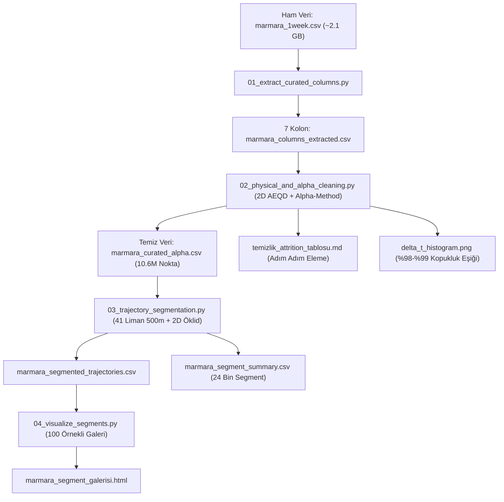

# Marmara Denizi AIS Veri Hattı, Kinematik Kürasyon ve Yörünge Segmentasyonu
## Grup Çalışması Ortak Proje Dokümanı ve Metodoloji Rehberi

> **Proje Kapsamı:** Marmara Denizi ve Boğazlar Bölgesi 1 Haftalık Ham AIS Verilerinin (~14 Milyon Kayıt) 2D Kartezyen Düzlemde İncelenmesi, Kinematik Limitler & $\alpha$-Yöntemi ile Temizlenmesi, Empirik Sinyal Kopukluğu Analizi ve Liman Tabanlı Sefer Segmentasyonu.  
> **Hazırlayanlar:** Bitirme Projesi Çalışma Grubu  
> **Son Güncelleme:** Kasım 2026

---

## 📑 İÇİNDEKİLER
1. [Projenin Amacı ve Büyük Resim](#1-projenin-amacı-ve-büyük-resim)
2. [Haversine'den 2D AEQD Kartezyen Düzleme Geçiş (Öklid Mesafesi)](#2-haversineden-2d-aeqd-kartezyen-düzleme-geçiş-öklid-mesafesi)
3. [Repodaki Betikler (Scripts) Ne Yapıyor? (Öğrenci Dostu Rehber)](#3-repodaki-betikler-scripts-ne-yapıyor-öğrenci-dostu-rehber)
4. [Kinematik Kürasyon Kuralları ve Adım Adım Attrition Tablosu](#4-kinematik-kürasyon-kuralları-ve-adım-adım-attrition-tablosu)
5. [Ampirik $\Delta t$ Dağılımı ve %98–%99 Sinyal Kopukluğu Eşiği](#5-ampirik-delta-t-dağılımı-ve-9899-sinyal-kopukluğu-eşiği)
6. [Yörünge Segmentasyonu Stratejisi (Liman Duruşu vs. Demirleme)](#6-yörünge-segmentasyonu-stratejisi-liman-duruşu-vs-demirleme)
7. [Hızlı Başlangıç ve Çalıştırma Adımları (Quickstart)](#7-hızlı-başlangıç-ve-çalıştırma-adımları-quickstart)
8. [Sıkça Sorulan Sorular (SSS)](#8-sıkça-sorulan-sorular-sss)

---

## 1. Projenin Amacı ve Büyük Resim

Denizcilikte gemilerin taşıdığı AIS (Automatic Identification System) cihazları saniyeler/dakikalar aralığında konum, hız, rota ve kimlik sinyalleri yayınlar. Ancak ham AIS verisinde:
- GPS sıçramaları (tekil hatalı konumlar),
- Aynı saniyede çelişkili sinyaller ($T_a = T_b$),
- Sensörün hız bilgisi gönderememesi (`NaN` veya AIS özel kodu `102.3 knot`),
- Fiziksel sınırların ötesinde ani hızlanma veya yanal ivmeler,
- Kıyıya yanaşmadan önceki günlerce süren demirleme beklemeleri mevcuttur.

**Projemizin Amacı:**
Ham AIS verisini fiziksel ve istatistiksel filtrelere tabi tutarak güvenilir hale getirmek, haritayı **Marmara merkezli 2D düzleme izdüşürerek Öklid geometrisiyle** modellemek, **ampirik veri dağılımına dayalı sinyal kopukluk eşiği** belirlemek ve nihai yörüngeleri **Limanlar Arası (`PORT_TO_PORT`)**, **Liman-Demirleme (`PORT_TO_ANCHOR`)** ve **Transit (`TRANSIT`)** seferlere segmentlemektir.



---

## 2. Haversine'den 2D AEQD Kartezyen Düzleme Geçiş (Öklid Mesafesi)

### Neden Küresel Haversine Yerine 2D Düzlem Seçtik?
1. **Bölgesel Doğruluk:** Marmara Denizi yaklaşık 250 km × 100 km boyutunda kapalı bir iç denizdir. Küresel dünya elipsoidi yerine Marmara'nın tam ağırlık merkezine ($40.75^\circ\text{ N}, 28.50^\circ\text{ E}$) teğet bir **Azimuthal Equidistant (AEQD)** düzlem tanımlandığında, merkezden 150 km yarıçapındaki distorsiyon (bozulma) ihmal edilebilir düzeydedir ($< \%0.02$).
2. **Hesaplama Hızı (Performans):** 14 milyon satırlık veride Haversine formülü yüz binlerce trigonometrik işlem (`sin, cos, arcsin, sqrt`) gerektirirken; 2D AEQD düzlemine izdüşürülen koordinatlarda mesafe doğrudan Pisagor/Öklid (`hypot(dx, dy)`) ile mikrosaniyeler içinde hesaplanır.

### Projeksiyon Tanımı (Python / PyProj)
```python
from pyproj import CRS, Transformer

# Marmara AEQD Düzlemi (Metre cinsinden 2D Kartezyen Düzlem)
marmara_duzlemi = CRS.from_proj4(
    "+proj=aeqd +lat_0=40.75 +lon_0=28.50 "
    "+datum=WGS84 +units=m +type=crs"
)
donusum = Transformer.from_crs("EPSG:4326", marmara_duzlemi, always_xy=True)

# Dereceden Metreye Dönüşüm
gemi_x, gemi_y = donusum.transform(gemi_lon, gemi_lat)
liman_x, liman_y = donusum.transform(liman_lon, liman_lat)

# 2D Öklid Mesafesi
mesafe_metre = np.hypot(gemi_x - liman_x, gemi_y - liman_y)

# Türetilen Hız (1 m/s = 1.943844 knot)
v_calc_knots = (mesafe_metre / dt_saniye) * 1.943844
```

---

## 3. Repodaki Betikler (Scripts) Ne Yapıyor? (Öğrenci Dostu Rehber)

Her bir script tek bir sorumluluğa (Single Responsibility) sahiptir ve sırayla çalıştırılır:

| Sıra | Script Adı | Girdi Dosyası | Çıktı Dosyası | Öğrenci Diliyle Ne Yapıyor? |
| :---: | :--- | :--- | :--- | :--- |
| **01** | [01_extract_curated_columns.py](file:///c:/Users/Lenovo/Desktop/BITIRME%20SON/01_extract_curated_columns.py) | `marmara_1week.csv` | `marmara_columns_extracted.csv` | **Gereksiz Kolonları Atma:** Ham 2.1 GB'lık dev CSV'den gemi adı, draft vb. statik alanları atıp sadece hareket için şart olan 7 dinamik kolonu (`mmsi`, `timestamp`, `lat`, `lon`, `speed`, `course`, `heading`) ayıklar. Hiçbir satır silmez. |
| **02** | [02_physical_and_alpha_cleaning.py](file:///c:/Users/Lenovo/Desktop/BITIRME%20SON/02_physical_and_alpha_cleaning.py) | `marmara_columns_extracted.csv` | `marmara_curated_alpha.csv`<br>`temizlik_attrition_tablosu.md`<br>`delta_t_histogram.png` | **Fiziksel Kürasyon & 2D Düzlem:** Koordinatları 2D AEQD düzlemine çevirir. $V_{\max}$, ivme sınırları, tekil GPS sıçramaları ve $\alpha$-Methodu ile gürültüyü eler. Adım adım kaç satır elendiğini raporlar ve $\Delta t$ histogramını çıkarır. |
| **03** | [03_trajectory_segmentation.py](file:///c:/Users/Lenovo/Desktop/BITIRME%20SON/03_trajectory_segmentation.py) | `marmara_curated_alpha.csv`<br>`Marmara_Final_Liman_Listesi.xlsx` | `marmara_segmented_trajectories.csv`<br>`marmara_segment_summary.csv` | **Seferlere Bölme (Segmentasyon):** 41 limanın 500m daireleri, $\ge 5$ dk duruş, $\ge 30$ dk demirleme ve ampirik $\Delta t$ kopukluğu ($12\text{ dk}$) ile gemi rotasını bağımsız sefer segmentlerine ayırır. |
| **04** | [04_visualize_segments.py](file:///c:/Users/Lenovo/Desktop/BITIRME%20SON/04_visualize_segments.py) | `marmara_segmented_trajectories.csv`<br>`marmara_segment_summary.csv` | `marmara_segment_galerisi.html`<br>`segment_gorsel_*.png` | **Görselleştirme & Sunum:** 100 örnek segmenti (30 Port-to-Port, 20 Port-to-Anchor, 20 Transit vb.) haritada gösteren butonlu etkileşimli galeri ve toplantı sunumu için PNG grafikleri üretir. |
| **Yardımcı** | [filter_marmara_ports.py](file:///c:/Users/Lenovo/Desktop/BITIRME%20SON/filter_marmara_ports.py) | `WPI2019.xls` | `marmara_denizi_limanlari.xlsx` | Dünya Port İndeksi'nden (WPI) Marmara sınırındaki liman koordinatlarını çeken ilk hazırlık aracı. |
| **Yardımcı** | [veri_kalite_ve_birim_kontrol.py](file:///c:/Users/Lenovo/Desktop/BITIRME%20SON/veri_kalite_ve_birim_kontrol.py) | `marmara_columns_extracted.csv` | Konsol Raporu | Kolonların veri tiplerini, eksik satır oranlarını ve min-max birim aralıklarını denetler. |

---

## 4. Kinematik Kürasyon Kuralları ve Adım Adım Attrition Tablosu

Kürasyon aşamasında (`02_...py`) uygulanan matematiksel filtreler:

1. **Zamansal Çakışma ($T_a = T_b$, $\Delta t = 0$):** Aynı MMSI aynı saniyede iki farklı konum bildiremez.
2. **2D Öklid ile Türetilen Hız ($v_{\text{calc}}$):**
   $$v_{\text{calc}} = \left(\frac{\sqrt{\Delta x^2 + \Delta y^2}}{\Delta t}\right) \times 1.943844 \quad (\text{knot})$$
3. **A $\rightarrow$ B $\rightarrow$ C Köprü Testi (GPS Sıçraması):** B noktası aşırı mesafedeyse ancak A'dan doğrudan C'ye bağlantı fiziksel olarak makulse, yalnızca hatalı B elenir; sağlam olan C noktası silinmekten kurtarılır.
4. **Hıza Bağlı Dinamik Açısal Hız ve Yanal İvme:**
   $$\omega_{\max}(v) = \min\left(2.0^\circ/\text{sn}, \, \frac{a_{\text{lat,max}}}{v_{\text{m/s}}} \times \frac{180}{\pi}\right), \quad a_{\text{lat,max}} = 1.0\text{ m/s}^2$$
5. **Mutlak Hız ($V_{\max} = 50.0\text{ knot}$) ve Çizgisel İvme ($a_{\text{tangential,max}} = 1.0\text{ m/s}^2$):**
   $$\left|\frac{\Delta v}{\Delta t}\right| > 1.94384\text{ knot/sn} \implies \text{Hatalı}$$
6. **Veriye Dayalı Dinamik Süzgeç: $\alpha$-Yöntemi ($\alpha = 0.05$, %95 Güven Aralığı):**
   $$\Delta v_{\text{signed}} = v_{\text{calc}} - \frac{\text{SOG}_A + \text{SOG}_B}{2}$$
   Marmara verisinde ampirik sınırlar: **$[-1.036, +1.350]\text{ knot}$**. Bu aralık dışı noktalar şüpheli işaretlenir.

### 📊 Adım Adım Veri Eleme (Attrition) Tablosu

| Adım | Kural / Filtre Adı | Elenen Satır | Kalan Satır | Adım Kaybı (%) | Kümülatif Kayıp (%) | Açıklama |
| :--- | :--- | :---: | :---: | :---: | :---: | :--- |
| **0. Ham Girdi** | Başlangıç Veri Seti | 0 | 13,968,687 | %0.00 | %0.00 | Ham çıkarılan 7 dinamik kolon. |
| **1. Format & Geçerlilik** | 9 Haneli MMSI, UTC Zaman, [-90,90] Lat | 0 | 13,968,687 | %0.00 | %0.00 | Bozuk format veya yerküre dışı kayıt yok. |
| **2. Marmara Sınırı** | IHO Sınır Kutusu ($39.9989^\circ - 41.2329^\circ\text{ N}$) | 0 | 13,968,687 | %0.00 | %0.00 | Veri seti önceden Marmara filtrelidir. |
| **3. Tam Kopya (Duplicate)** | Birebir Aynı MMSI, Zaman, Lat, Lon, SOG | 2,212,461 | 11,756,226 | %15.84 | %15.84 | Mükerrer baz istasyonu paketleri temizlendi. |
| **4. Zamansal Çakışma** | $T_a = T_b$ (Aynı Saniyede Farklı Konum) | 22,521 | - | %0.16 | - | Çelişkili saniyeler şüpheliye alındı. |
| **5. Tekil GPS Sıçraması** | A $\rightarrow$ B $\rightarrow$ C Köprü Testi | 4,692 | - | %0.03 | - | Masum C korunup ortadaki hatalı B elendi. |
| **6. Fiziksel Hız Sınırı** | $V_{\max} > 50\text{ knot}$ veya Mesafe Aşımı | 21,433 | - | %0.15 | - | 50 knot üstü fizik dışı sıçramalar. |
| **7. Yanal İvme & Dönüş** | $a_{\text{lat}} > 1.0\text{ m/s}^2$ veya $\omega > \omega_{\max}(v)$ | 501,228 | - | %3.59 | - | Fiziksel dönüş kabiliyeti aşımı. |
| **8. Çizgisel İvme Sınırı** | $a_{\text{tangential}} > 1.0\text{ m/s}^2$ (~1.94 kn/sn) | 462 | - | %0.003 | - | Motor gücü ivmelenme sınırı. |
| **9. $\alpha$-Method Süzgeci** | $\Delta v \notin [-1.04, +1.35]\text{ knot}$ (%95 Dışı) | 553,382 | - | %3.96 | - | Konum hızı ile sensör hızı uyuşmazlığı. |
| **10. Tamamlanamayan Hız** | Hız Boş/102.3 ve Konumdan Türetilemedi | 39,276 | - | %0.28 | - | 42,721 eksik hız kurtarıldı, kalanlar elendi. |
| **ÖZET BİLANÇO** | **Tüm Filtrelerin Birleşimi (OR)** | **1,107,842** | **10,648,384** | **%7.93** | **%23.77** | Tekil şüpheli satırlar temizlendi. |
| **NİHAİ TEMİZ VERİ** | **2D AEQD Koordinatlı Güvenilir Veri** | **0** | **10,648,384** | **%0.00** | **%23.77** | **Modellemeye hazır nihai veri seti.** |

---

## 5. Ampirik $\Delta t$ Dağılımı ve %98–%99 Sinyal Kopukluğu Eşiği

Birçok çalışmada sinyal kopukluğu eşiği (Time Gap Threshold) ezbere 30 veya 60 dakika seçilir. Projemizde Marmara verisindeki **10,645,033 ardışık sinyal aralığının** ampirik kümülatif dağılımı (CDF) çıkarılmıştır:

| Kantil Seviyesi | Saniye | Dakika | Yorum |
| :---: | :---: | :---: | :--- |
| **%50 (Medyan)** | 12.0 sn | 0.20 dk | Gemilerin yarısı her 12 saniyede bir sinyal göndermektedir. |
| **%75** | 31.0 sn | 0.52 dk | Verinin 3/4'ü 30 saniye altındadır. |
| **%90** | 180.0 sn | 3.00 dk | Normal seyirdeki periyodik aralık. |
| **%95** | 358.0 sn | 5.97 dk | Kısa süreli gecikmeler. |
| **%98** | **538.0 sn** | **8.97 dk (~9 dk)** | **Verinin %98'ini kapsayan ampirik eşik.** |
| **%99** | **721.0 sn** | **12.02 dk (~12 dk)** | **Verinin %99'unu kapsayan ampirik eşik.** |
| **%99.5** | 1257.0 sn | 20.95 dk | Nadir kopmalar. |
| **%99.9** | 4975.9 sn | 82.93 dk | Ciddi sinyal kesintileri / cihaz kapanmaları. |

> **Metodolojik Çıkarım:** Verideki ardışık sinyallerin **%99'u 12 dakika içinde** gelmektedir. Dolayısıyla **12 dakikayı aşan bir sessizlik**, normal bir sinyal gecikmesi değil, kesin bir **sinyal kopukluğudur (time gap)**. Segmentasyon betiğimizde eşik ampirik olarak **12.0 dakika** olarak uygulanmıştır.

---

## 6. Yörünge Segmentasyonu Stratejisi (Liman Duruşu vs. Demirleme)

[Marmara_Final_Liman_Listesi.xlsx](file:///c:/Users/Lenovo/Desktop/BITIRME%20SON/Marmara_Final_Liman_Listesi.xlsx) dosyasında 41 adet liman merkezi koordinatı tanımlıdır.

### Segment Ayrım Mantığı
1. **Liman Uğrağı / Duruşu (`PORT_STOP`):** Gemi en yakın limanın **500 metre** dairesi içindeyse, hızı $\le 0.5\text{ knot}$ (duruş) ise ve burada **en az 5 dakika** kalmışsa bu bir "Liman Uğrağı"dır.
2. **Demirleme (`ANCHOR_STOP`):** Gemi liman dairesinin dışındaysa ($d > 500\text{ m}$), hızı $\le 0.5\text{ knot}$ ise ve **en az 30 dakika** beklemişse (Ahırkapı, Tuzla, Tekirdağ açıklarında demirde bekleme) bu bir "Demirleme Olayı"dır.
3. **Seyir Segmenti (`UNDERWAY`):** Duruş ve demirleme haricindeki hareketli noktalar, aralarında **$> 12\text{ dakika}$** kopukluk olmayan ve **$\ge 10\text{ dakika}$** süren bağımsız sefer segmentlerine dönüştürülür.

### Segment Kategorileri Dağılımı (24,371 Segment)
- **`TRANSIT_OR_PARTIAL` (%51.9):** Boğazlardan Karadeniz/Ege'ye transit geçen seferler.
- **`ANCHOR_TO_ANCHOR` (%33.5):** Demirleme sahaları arası yer değiştirme manevraları.
- **`PORT_ROUNDTRIP` (%3.8):** Aynı limandan çıkıp geri dönenler (römorkör, kılavuz, yerel tekneler).
- **`PORT_DEPARTURE` & `PORT_ARRIVAL` (%5.9):** Limandan kalkıp Boğazlara gidenler veya Boğaz'dan gelip limana yanaşanlar.
- **`PORT_TO_ANCHOR` & `ANCHOR_TO_PORT` (%4.4):** Liman ile açıkta bekleme sahası arasındaki seferler.
- **`PORT_TO_PORT` (%0.4 - 91 Segment):** Bir limandan çıkıp hiç demirlemeden doğrudan başka bir limana giden net seferler.

---

## 7. Hızlı Başlangıç ve Çalıştırma Adımları (Quickstart)

Tüm analiz hattını sıfırdan çalıştırmak için Windows PowerShell terminalinde şu adımları takip edin:

```powershell
# 1. Sanal ortam veya Python ortamında gerekli kütüphaneleri yükleyin:
pip install pandas numpy pyproj matplotlib folium openpyxl

# 2. Adım 1: Ham veriden 7 dinamik hareketi kolonunu ayıklayın
python 01_extract_curated_columns.py

# 3. Adım 2: 2D Kartezyen düzlem dönüşümü, fiziksel temizlik ve Delta t analizi
python 02_physical_and_alpha_cleaning.py

# 4. Adım 3: 2D Öklid mesafesiyle Liman ve Sefer Segmentasyonu
python 03_trajectory_segmentation.py

# 5. Adım 4: 100 Örnekli Kategori Filtreli Etkileşimli Galeriyi Üretin
python 04_visualize_segments.py
```

İşlem tamamlandığında [marmara_segment_galerisi.html](file:///c:/Users/Lenovo/Desktop/BITIRME%20SON/marmara_segment_galerisi.html) dosyasını çift tıklayarak tarayıcınızda açabilir; üstteki butonlarla **Port-to-Port**, **Port-to-Anchor** veya **Transit** seferleri arasında gezinebilirsiniz.

---

## 8. Sıkça Sorulan Sorular (SSS)

### S1: Neden Haversine yerine 2D Düzlem kullandık? Hoca sorarsa ne diyeceğiz?
> *"Marmara Denizi bölgesel bir iç deniz olduğu için küresel elipsoid hesaplamaları gereksiz hesap yükü getirmekteydi. Marmara'nın ağırlık merkezine ($40.75^\circ\text{ N}, 28.50^\circ\text{ E}$) teğet Azimuthal Equidistant (AEQD) projeksiyon düzlemi tanımlayarak koordinatları metreye çevirdik. Bu düzlemde distorsiyon ihmal edilebilir düzeydedir ($< \%0.02$) ve mesafeler doğrudan Öklid metriği ile hesaplanabilmektedir."*

### S2: Alpha-Method eşiği neden negatif çıktı? (-1.036 knot ne demek?)
> *"-1.036 knot bir hız değil, **hız sapmasıdır (hata payıdır)**. $\Delta v = v_{\text{calc}} - v_{\text{reported}}$ formülünde geminin haritadaki yer değiştirmesi, gemi kadranındaki hızdan 1.036 knot daha düşük kalmış demektir (akıntıya karşı seyir veya sensör kalibrasyonu). %95 güven aralığının $[-1.04, +1.35]\text{ knot}$ çıkması, verideki hız sensörlerinin GPS konumlarıyla $\pm 1\text{ knot}$ hassasiyetle birebir tutarlı olduğunu kanıtlar."*

### S3: Sinyal kopma eşiğini neden 12 dakika aldık?
> *"Keyfi bir 30 dakika eşiği seçmek yerine, veri setimizdeki 10.6 milyon ardışık zaman farkının ($\Delta t$) ampirik dağılımını çıkardık. Verinin tam %99'unun 12 dakika içinde geldiğini tespit ettik; bu nedenle 12 dakikayı aşan boşlukları bilimsel olarak sinyal kopukluğu kabul ettik."*
